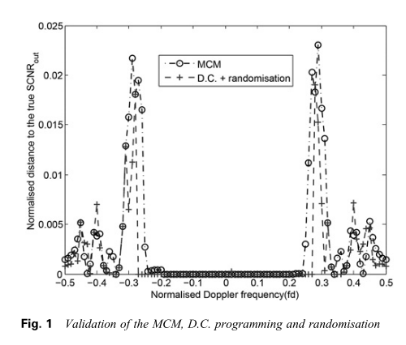
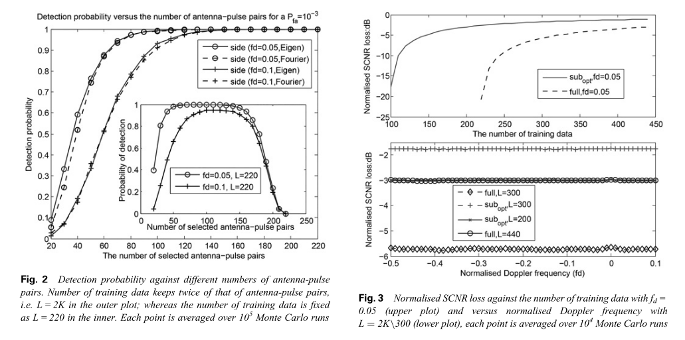
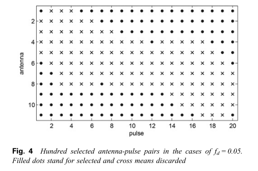
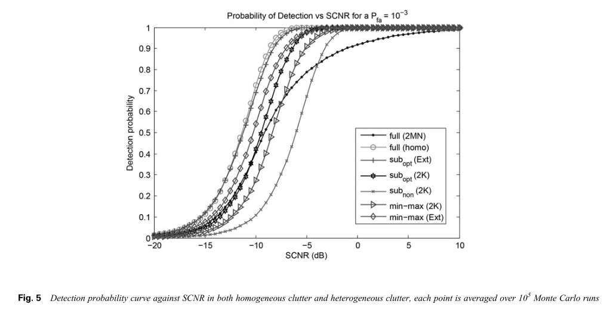
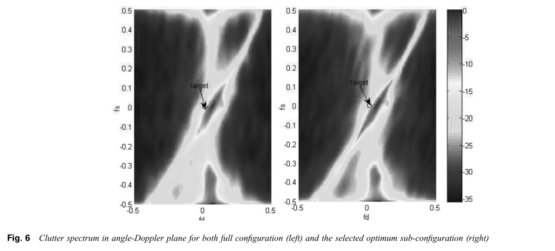
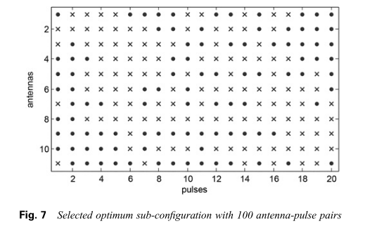
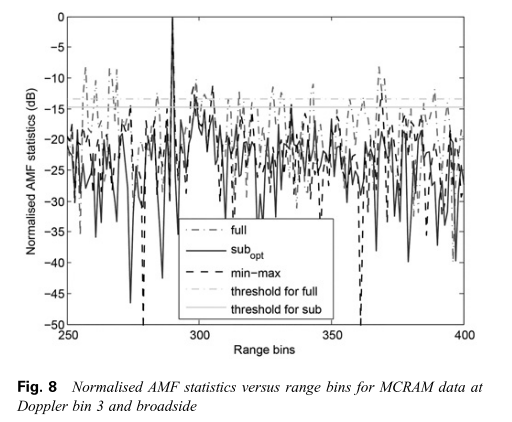

# [Space-Time Adaptive Processing STAP]Sparse Space-Time Adaptive Processing for Radar Slow Target Detection in Noise

Introduction to Spatio-Temporal Adaptive Processing (STAP) involves the linear combination of signals from an antenna array and multiple pulses to enhance the detection performance of airborne radar in severe clutter and interference environments [1-3]. The optimal STAP processor employs a clutter plus noise covariance matrix (CCM) to eliminate the application of matched filter detectors before receiving data. Since the CCM is typically unknown, actual STAP methods, such as the sample matrix inversion (SMI) method, obtain the CCM from maximum likelihood estimates of the CCM obtained from auxiliary cells. The number of independent identically distributed (IID) training data required for the SMI, ensuring an average signal-clutter plus noise ratio (SCNR) loss of 3 dB, is twice the number of DoF for the detectors. For common STAP applications, this is generally on the order of hundreds, and can easily exceed available data measurements [4]. For non-isotropic environments, due to the lack of sufficient IID training data, SMI can lead to significant performance degradation [5].
The actual implementation of STAP, in addition to the challenges posed by clutter heterogeneity and limited sample support, continues to face other issues, including high computational costs in real-world scenarios. Fortunately, most interference suppression problems in airborne radar systems are essentially rank deficiency, meaning they require less adaptive freedom than the array provides. By proper design, redundant DoF can be discarded, and partial STAP [6] can be applied. For example, preprocessing can be used to select training data statistically representative to alleviate clutter heterogeneity [7-11]. Knowledge-aided STAP combines prior knowledge into the estimation process to accelerate CCM convergence [12-15]. Algorithms that only test data, such as D3 algorithm [16] and maximum likelihood detector (MLED) [17], do not require training data. An image processing-based STAP technique was proposed in [18]. Principal Component Analysis (PCA) projects data onto a low-dimensional subspace to reduce high sample support. Some recent works have considered exploiting the angle Doppler plane motion of moving targets from clutter spectra using sparse recovery (SR) techniques [21, 22]. However, these SR methods are computationally more complex than traditional STAP, being expensive due to the need for full-dimensional matrix inversion and additional computations required during the recovery process. Work in [23, 24] assumes the sparsity property of STAP filter weights rather than clutter spectra and uses l1 norm to enhance sparsity.
In this paper, we propose a novel sparse STAP method including an antenna pulse selection strategy. We select the best subset of antenna pulse pairs for each distance gate before applying STAP and target detection with the antenna array. Traditional selection strategies separate the antenna array from the pulse sequence and only check the selection on the array for ground clutter suppression in airborne radars [25, 26]. In contrast, we believe that interleaved antenna pulse data can be treated as a virtual large array where each sensor specifies the number of antennas and pulses. By jointly selecting the antenna pulses at both spatial and temporal levels, we achieve a "refinement" of the antenna pulse pair subset that includes the best sensor elements. Compared to our work in [27], our work achieves antenna pulse selection by maximizing the separation between the target and the nearest clutter Fourier basis, and the contributions of this paper are (i) we redefine parameters called Spatial Spectral Correlation Coefficient (S2 C2), which uses the degree of separation between the target subspace and clutter subspace to analytically express the output SCNR; (ii) we devise and implement antenna pulse selection such that the resulting spatio-temporal configuration maximizes the output SCNR; (iii) we present two effective algorithms for the selection process; (iv) we investigate the feature basis selection problem, which performs slightly better than the Fourier basis selection; and (v) in addition to extensive simulations, we also evaluate the performance of the proposed antenna pulse selection strategy using single-base station multi-channel airborne radar measurement (MCARM) data.
This paper proposes a new perspective, which we believe that interleaved antenna pulse data forms a single large sensor array and studies the selection of this large sensor array using sparse STAP. Each sensor specified by antenna number and pulse number corresponds to an antenna-pulse pair. The S2 C2 algorithm has been improved to enhance the spatiotemporal separation between the target and clutter subspace. On the basis of S2 C2, we have implemented antenna pulse selection as maximization of SCNR as output, and proposed two algorithms to select the optimal antenna pulse pairs based on Fourier base and eigenbase. Simulation and MCARM experimental data verify the effectiveness of the antenna pulse selection strategy, while reducing computational load, solving clutter heterogeneity and limited sample support simultaneously, also proving its effectiveness in robust radar target detection.

## Images

<!-- PAYMENT_BLOCK -->

## Get this dataset

- Payment link (Stripe): [Buy now](https://buy.stripe.com/3cs8yP7sY87d0vu9AB)
- Payment QR code: 

<!-- /PAYMENT_BLOCK -->
